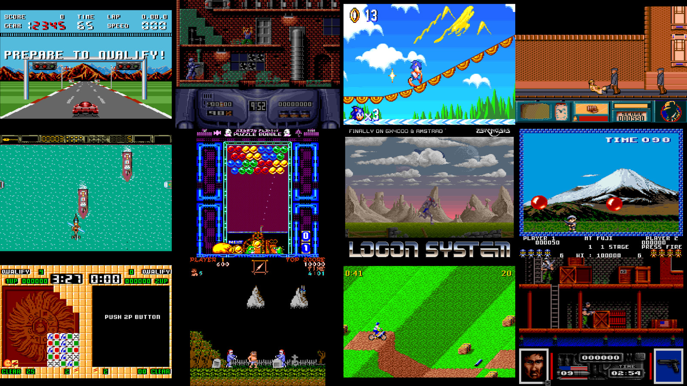

# Amstrad CPC, Plus and GX4000 for MiSTer

This experimental fork of the [MiSTer Amstrad core](https://github.com/MiSTer-devel/Amstrad_MiSTer) supports classic CPC models and adds an Amstrad Plus/GX4000 path. Classic CRTC types 0 and 1 are being refined against real hardware and the [Amstrad CPC CRTC Compendium](https://shaker.logonsystem.eu/).

The core is in active development. Many games run, but compatibility is incomplete. See [known issues](docs/known-issues.md) before reporting a problem and the [roadmap](docs/roadmap.md) for the broad direction.

## Install

1. Download the latest `.rbf` from [Releases](https://github.com/renaudguerin/Amstrad_MiSTer/releases).
2. Copy it to `/media/fat/_Computer/` on the MiSTer SD card.
3. Copy [`boot.rom`](roms/boot.rom) to `/media/fat/Games/Amstrad/boot.rom`. The core needs this file to boot.
4. Put disk images (`.DSK`) or Plus cartridges (`.CPR`) in `/media/fat/Games/Amstrad/` and mount them from the core menu. Select the appropriate machine model.

For a disk, `CAT` lists files and `RUN"program` starts a BASIC program. `|A` and `|B` select drives. Tape loading supports `.CDT` files with `|TAPE` and `RUN"`; tape seek and rewind are not supported.

## Features

- CPC 464, 664 and 6128 modes, two disk drives, expansion ROMs, joystick and mouse support, Multiface 2, and basic CDT tape input.
- Plus and GX4000 cartridge loading, ASIC palette and sprites, split screen and scrolling, raster interrupts, and three channel audio DMA.
- Separate CRTC type 0 and type 1 engines for classic video timing, and selectable sync filtering.
- CPC+ snapshot loading. The OSD can save a classic CPC snapshot as a development aid, but saving it directly to the SD card is not yet available.

Compatibility and hardware accuracy vary by title and feature. Please include the core release or commit, machine model, media, reproduction steps and a photograph or capture in [bug reports](https://github.com/renaudguerin/Amstrad_MiSTer/issues).

## Build and contribute

See [building](docs/building.md), [simulation tests](sim/README.md), [documentation](docs/README.md) and [credits](CREDITS.md). The FPGA project is `Amstrad.qpf` and targets Quartus Prime Lite 17.0.2.
